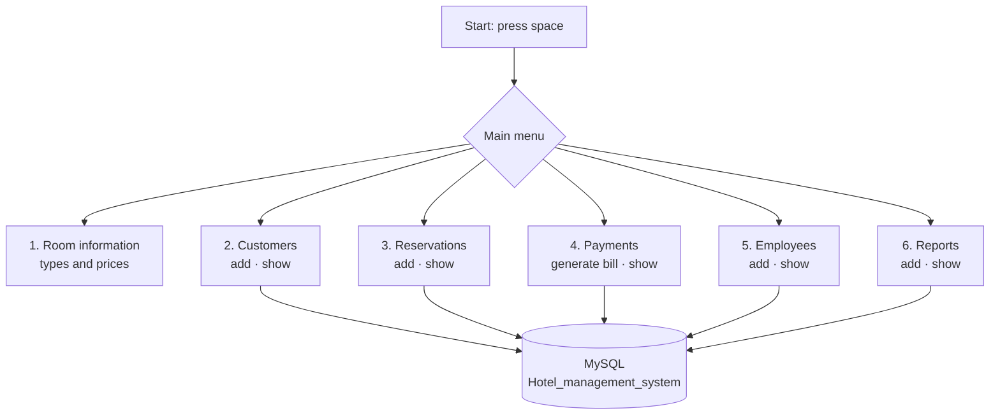

# Hotel Management System

A menu-driven command-line program for a small hotel, "The Inn Plaza", written in Python with a **MySQL** database. Staff can look up room types and prices and record customers, reservations, payments, employees and reports.

## What it does



| Room | Includes | Price |
|---|---|---|
| Standard 2 Bed AC | Restaurant and pool access | ₹2,000 / day |
| 3 Bed AC | Restaurant and pool access | ₹3,000 / day |
| Suite (2 bedrooms, living room, 2 baths) | Restaurant and pool access | ₹5,000 / day |

### Tables

The program creates each table the first time it's used:

| Table | Holds |
|---|---|
| `Customer_Information` | Customers, with a random customer ID |
| `Reservations` | Room, reservation, check-in and check-out dates, duration |
| `Payments` | Amount, payment mode, services, date |
| `Employees` | Staff records |
| `Reports` | Notes against a customer and room |

## Running it

1. Install MySQL and create the database:

   ```sql
   CREATE DATABASE Hotel_management_system;
   ```

2. Install the connector:

   ```bash
   pip install mysql-connector-python
   ```

3. Put your MySQL username and password into the `sql.connect(...)` call near the top of `client.py`, then run it:

   ```bash
   python client.py
   ```

## Known issues

- `client.py` doesn't run as it is: the `sql.connect(...)` call on lines 13–14 is missing a comma before `auth_plugin`. Add the comma to fix it.
- Each run handles one menu choice and then exits.
- Database credentials are written into the code rather than read from settings.

## Tech stack

Python · MySQL · mysql-connector-python
